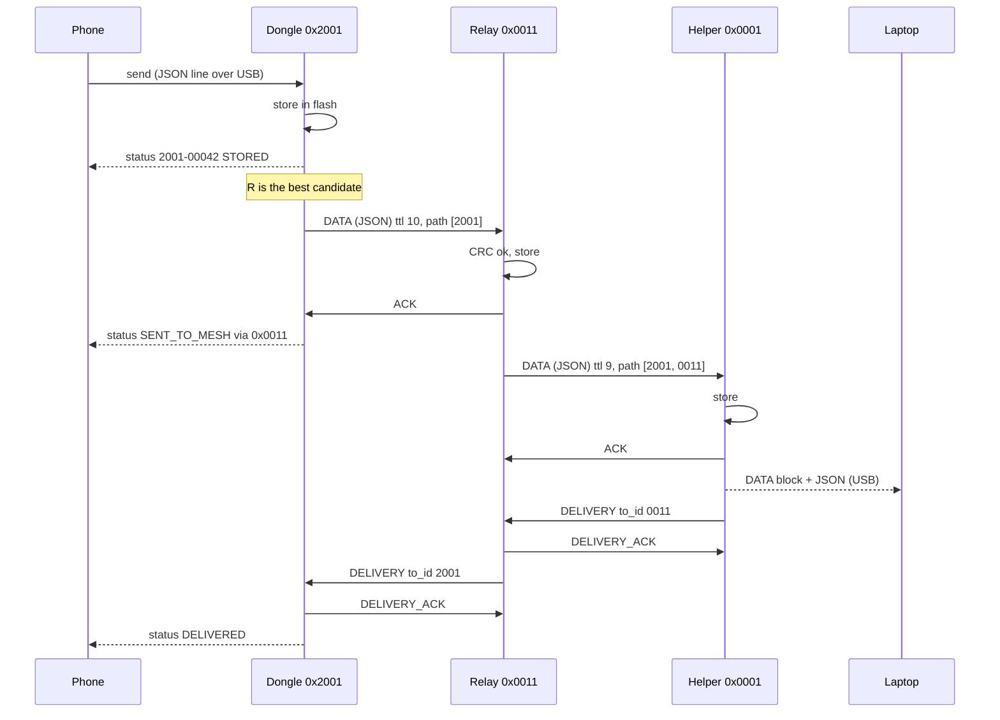

# Dhruva Jaal: algorithm design (V1)

How every node decides **when** to transmit, **to whom**, and what it does with each packet it receives. It covers any number of nodes. The packet formats are in [packet-design.md](packet-design.md). The build plan, hardware and milestones are in [plan.md](plan.md). The firmware that implements it is [../firmware/firmware.ino](../firmware/firmware.ino).

## Core rules

```
VERIFY  before STORE      (CRC8 + length + version)
STORE   before ACK        (flash write finishes before the ACK goes out)
STORE   before FORWARD    (a message is never only in RAM)
RETRY   when ACK is missing
DEDUPLICATE by (source_id, message_id)
LIMIT   propagation with TTL
USE     geography to pick the next hop instead of flooding
KEEP    several forwarding options for resilience
PREFER  reliability over latency
```

Priority order: **reliability > link stability > network capacity > latency.**

## 1. Roles

Each role runs the same mesh code. Only the role flag at the top of the firmware differs.

| | Helper | Relay (balloon or ground) | Dongle |
| --- | --- | --- | --- |
| Sends HELLO / INI | yes | yes | **never** |
| Accepts DATA | yes (final stop) | yes, stores and forwards | **no** (never relays) |
| Sends | ACK, DELIVERY | ACK, forwarded DATA, DELIVERY, DELIVERY_ACK | its own DATA, DELIVERY_ACK |
| GPS | no (fixed position) | NEO-6M, fixed position until the first fix | no (position comes from the phone) |
| USB side | readable DATA block + JSON log to the PC | JSON log, test commands | phone protocol + test commands |
| In others' neighbour tables | yes | yes | no |

The dongle is a mesh **edge** node. It originates its own messages and receives ACK and DELIVERY for them, but it never forwards anyone else's. That keeps trapped people's batteries for their own SOS, and it keeps dongles, which appear and disappear, out of routing.

## 2. Channel access: one channel, listen before talk

Every node uses the same channel (433.175 MHz) for every packet. The SX1278 is half-duplex: it hears that channel whenever it is not transmitting.

| Packet | How it goes out |
| --- | --- |
| DATA, DELIVERY, HELLO, INI | **CAD first** (Channel Activity Detection, ~8 ms). Busy → wait `random(1..4)` SLOTs and try again; that is not counted as a retry. |
| ACK, DELIVERY_ACK | **At once**, no CAD: the sender is waiting for it, and everyone else defers to the exchange they can hear. |

`SLOT = 1.3 s` fits the longest packet (a JSON DATA with a full path, 1.23 s). A sender waits **1 SLOT after its TX ends** for the ACK: the receiver's JSON parse and flash write (tens of ms) plus the 144 ms ACK fit easily inside it.

**CAD caveat:** SX127x CAD only detects a **preamble**. A packet already past its preamble is invisible to it. The random backoff after a busy channel or a lost ACK spreads senders out so this stays rare; when two packets do collide, the ACK is missing and the retry rules (section 7) take over.

**HELLO timing** (infra only): every `HELLO_INTERVAL` plus a random jitter of up to a sixth of it, so beacons don't line up.

| Parameter | Demo | Deployment (first guess) |
| --- | --- | --- |
| HELLO interval | 10 s (+ 0–1.7 s) | 60 s (+ 0–10 s) |
| Neighbour STALE after | 3 missed HELLOs (35 s) | 3 missed HELLOs (3.5 min) |
| Neighbour forgotten after | 10 HELLO intervals | 10 HELLO intervals |

With 40 balloons in line of sight, 40 × 185 ms every 60 s is about 12 % channel load for beacons.

What one channel does not fix: everything ends at the helper. Helper capacity, about 1,000–1,500 messages per hour, is the bottleneck. Larger areas need more helpers (V2). Spreading exchanges over several channels (TDM + FDM) is a V2 option.

## 3. Neighbour discovery (infra nodes)

Every HELLO and INI received with a good CRC updates the neighbour table. Discovery is **not** a blocking startup phase: a node starts receiving, forwarding and beaconing straight away. An infra node sends an INI at a random moment 0–2 s after boot, and another one on its first GPS fix.

**Range filter (demo only).** `DEMO_RANGE_KM` (0 = off) is applied first, on every node including dongles: a beacon from a sender farther than `DEMO_RANGE_KM` from this node's position is dropped, so that sender never becomes a neighbour or a candidate. This lets three boards on one table act like nodes 4 km apart. DATA, ACK and DELIVERY need no filter, because they are addressed by `next_hop_id` / `to_id`.

**Neighbour entry** (table of 16; when it is full, the oldest non-ACTIVE entry is replaced):

```
node_id, role, position
rssi (last), snr (average, EWMA alpha = 0.25)
last_seen, hello_count
ack_history (last 10 sends: ok / fail bits)
state
```

**States:**

```
          any HELLO/INI
   ──────────────────────────> HEARD
                                 │ ≥ 3 HELLOs AND snr > -10 dB
                                 v              (SF9 floor ≈ -12.5 dB → 2.5 dB margin)
                               ACTIVE
                                 │ 3 consecutive HELLOs missed
                                 │ OR ACK success < 50 % over the last 10 sends (≥ 5 sends)
                                 v
                               STALE ──> forgotten after 10 HELLO intervals of silence
```

- A STALE neighbour that is heard again goes back to HEARD with `hello_count = 0` and a cleared ACK history. It has to earn ACTIVE again with 3 fresh HELLOs. Without that probation, a neighbour made STALE by its ACK rate would never be tried again and could never recover.
- **Balloons drift:** the position is overwritten on every HELLO, and progress to the helper is computed from the latest one.
- A node accepts DATA from **any** node or dongle that names it as `next_hop_id`. Refusing inbound would strand dongles.

**Dongle candidate list.** Dongles use the same table but don't wait for ACTIVE: a candidate is any infra node heard in the last 3 HELLO intervals. The number of candidates is the `nodes` value in `info` to the phone app.

## 4. Routing: choosing the next hop

Each node routes on its own using local geography. There are no route tables and no full A*. Each node knows:

```
MY position         (GPS, or the fixed position)
HELPER position     (the same constant on every node)
NEIGHBOUR positions (from their HELLOs)

progress(n) = dist(me, helper) - dist(n, helper)     (2D, altitude ignored; the helper's own distance is 0)
```

### Infra node (relay)

```
candidates = ACTIVE neighbours
             minus nodes already in path_history          (loop prevention)
             minus nodes that already failed for this message
order: progress > 0 first, then higher ACK success rate, then higher SNR
pick the first; none with progress > 0 -> the best of the rest (recovery)
nothing left -> the message stays STORED, state WAITING
```

A neighbour with no sends yet counts as a 100 % ACK rate, so new links get tried. The "4 forwarding neighbours" of `packet v2` are the top 4 of this order; since the pick is always the best usable candidate, the firmware ranks all ACTIVE neighbours directly.

### Dongle

```
candidates = infra nodes heard in the last 3 HELLO intervals,
             minus those that already failed for this message
pick the highest SNR; within 1 dB of it -> the one with the most progress to the helper
none -> WAITING (the phone never has to resend)
```

Dongles pick by SNR first because a trapped dongle's weakest link is its first hop.

### Never drop a message

```
5 retries to the current next hop fail
    -> mark that neighbour as failed for this message, reset the retry count
    -> pick the next candidate
all candidates fail
    -> keep the message STORED, state WAITING
    -> try again when a neighbour becomes ACTIVE or moves (dongle: when any node is heard)
    -> and every 60 s (the failed list is cleared, so recovered neighbours are tried again)
```

A node marks a message **FAILED** only when it receives it with `ttl == 0` and it is not the helper. The message stays stored there. No packet reports FAILED back to the source: the source keeps the message as SENT_TO_MESH and simply never gets a DELIVERY.

## 5. Receive algorithm

The firmware polls the radio every loop (`LoRa.parsePacket()`); no interrupts. A packet starting with `{` is a JSON DATA; anything else is a binary packet.

```
on_rx(buf, len, rssi, snr):
    buf[0] == '{':                       // JSON DATA
        not valid JSON, "t" != "DATA", a field missing,
        or path not 1..11 entries        -> drop
        next_hop_id != me                -> drop; else on_data
    else:                                // binary
        crc8(buf[0..len-2]) != buf[len-1] -> drop
        version (buf[0] >> 4) != 1        -> drop
        len != expected_len(type)         -> drop  // HELLO 18, INI 23, the rest 10
    switch type:
      HELLO, INI:   range filter; neighbour update; INI -> check helper_id
      DELIVERY:     to_id == me       -> on_delivery
      ACK, DELIVERY_ACK: only used while waiting for one (section 6)
```

### on_data: the store-before-ACK path

```
key      = (source_id, message_id)
prev_hop = path_history[path_count - 1]

if seen(key):                         // a retransmission: our ACK was lost
    send ACK now to prev_hop; return
if I am a dongle:                     // dongles never accept DATA
    return
if the store is full:                 // no ACK: the sender keeps it and tries elsewhere
    return

store(packet, prev_hop)               // flash
send ACK now to prev_hop              // no CAD, no backoff
add key to the seen list

if I am the helper:                   // the helper is the final stop for every DATA
    mark DELIVERED; print the DATA block; log JSON
    queue DELIVERY to prev_hop
elif ttl == 0:
    mark FAILED (TTL expired)
else:
    queue FORWARD
```

### on_delivery

```
send DELIVERY_ACK now (ack_to = stored next_hop, or 0xFFFF without a record)
if already DELIVERED: return                // a repeat: our DELIVERY_ACK was lost
mark DELIVERED                              // also stops sending it, if our hand-off ACK was lost
if source_id == me: report DELIVERED to the phone (dongle); return
queue DELIVERY to the stored prev_hop
```

## 6. Transmit algorithm

Each stored message carries its own retry state (next hop, retry count, failed neighbours, next try time, waiting). Each loop sends **one** due message:

- **DELIVERY first** (short, and it frees state upstream), then **own** messages, then **forwarded** ones, oldest first.

### One exchange

```
CAD
    busy -> try again in random(1..4) SLOTs (not a retry)
build the packet:
    forward   the stored DATA, ttl--, append my id, next_hop_id = target, as JSON
    own       the stored DATA, next_hop_id = target, as JSON
    DELIVERY  helper_id, to_id = target, key
send, then listen for 1 SLOT
    ACK match:          ack_from == target AND ack_to == me AND key
    DELIVERY_ACK match: ack_from == target AND key
    any other packet meanwhile is handled as usual
match:
    DATA:     store next_hop = target, state SENT_TO_MESH (handed off)
    DELIVERY: done
no match:
    retries++
    retries <= 5 -> next try after random(1 .. min(2^retries, 16)) SLOTs
    retries >  5 -> DATA: this neighbour failed for this message, pick another
```

| Retry k | Backoff before it |
| --- | --- |
| 1 | 1–2 SLOTs |
| 2 | 1–4 SLOTs |
| 3 | 1–8 SLOTs |
| 4 | 1–16 SLOTs |
| 5 | 1–16 SLOTs |

A neighbour costs at most 6 TX plus 46 SLOTs (about 65 s) before the next candidate is tried.

**DELIVERY retries.** The target of a DELIVERY is fixed (the stored prev_hop), so there is no "next candidate". After 5 failed retries the DELIVERY waits 60 s and starts a new round of 5. After 5 rounds it gives up. A dongle that was switched off or moved should not keep a relay transmitting forever.

## 7. End to end



## 8. Message states

These are kept per message on every node. The dongle also reports them to the phone (`status`, [../docs/usb-protocol.md](../docs/usb-protocol.md)).

| State | Meaning | In flash? |
| --- | --- | --- |
| QUEUED | dongle got a `send`, not yet written | no |
| STORED | in flash, not handed off yet | yes |
| WAITING | stored, no usable neighbour | no (a STORED message waiting) |
| TRANSMITTING | an exchange for it is in progress | no |
| SENT_TO_MESH | a next hop ACKed it (handed off) | yes |
| DELIVERED | DELIVERY received (or this node is the helper) | yes |
| FAILED | dongle: could not store it (store full); relay: TTL ran out here | relay only |

The dongle sends each state to the phone once, when it changes.

## 9. Storage

Messages live in `Preferences` (the ESP32's NVS flash), so they survive a reboot:

| Kept | Size | Notes |
| --- | --- | --- |
| Stored messages | 50 (dongle 16) | the DATA fields as received, prev_hop, next_hop, state, DELIVERY progress |
| Seen keys | last 200 | keys of messages already accepted, so a repeat is ACKed but not stored again |
| Own message counter | 1 | `message_id` never repeats, even after a reboot or `erase` |

- **Store before ACK:** the message is written to flash before the ACK goes out. The seen key is written right after the ACK; until then the stored message itself marks it as seen.
- **Eviction:** when the store is full, the oldest DELIVERED (or FAILED) message makes room, then the oldest one already handed off. A message that still has to be sent, or that still owes a DELIVERY, is never evicted. If those alone fill the store, the node stops accepting DATA (no ACK), and its neighbours route around it.
- **Reboot:** stored messages are reloaded and carry on: STORED ones are sent again, owed DELIVERYs go out. That is why a relay rebooted mid-flow loses nothing and the PC shows no duplicate.
- **Scaling up:** the design target (1,000 messages, 10,000 seen keys per node) needs a raw flash partition with erased space kept ready, so a write never waits for a sector erase. That is the next step after the MVP.

## 10. Positions and GPS

| Node | Position used in HELLO / INI and for routing |
| --- | --- |
| Relay (balloon, ground) | NEO-6M live fix: `gps_fix = 1`, `position_acc ≈ HDOP × 2.5 m`. Before the first fix: the fixed position from the top of the firmware, `gps_fix = 0`. After a fix is lost (> 10 s): the last GPS position, `gps_fix = 0`. The first fix triggers an INI. |
| Helper | Its fixed position, the same one every node uses as the helper position. |
| Dongle | DATA carries the **phone's** position from `send` (0, 0 with `acc` 255 if the phone has no fix). The dongle's fixed position is used only for the demo range filter. |

## 11. Failure behaviour

| What happens | What the mesh does |
| --- | --- |
| Next hop is off | 5 retries with backoff, then the next candidate; no candidate → WAITING; sent when a neighbour reappears (store and forward) |
| ACK lost | Sender retries; receiver sees a repeat, does not store it again, ACKs again |
| ACK lost, and the sender already moved to another neighbour | Two copies travel; the helper de-duplicates; DELIVERY returns along the first path; the DELIVERY_ACK match on `ack_from` + key still closes it |
| Relay reboots mid-flow | Messages and seen keys are in flash; sending resumes at boot; no duplicate at the helper |
| Helper off | Every message waits (STORED / WAITING) at the last relay or the dongle and goes out when the helper's HELLOs return |
| Routing dead end (no neighbour makes progress) | Recovery: any candidate not in `path_history`; TTL stops it after 10 hops |
| Balloon drifts | Its position is refreshed on every HELLO, and next-hop choices follow it |
| Store full | No ACK, so upstream nodes keep their copy and route elsewhere; nothing is overwritten that was not handed off |
| Channel busy | CAD, then a random 1–4 SLOT wait (not counted as a retry) |
| Two senders start at once | Both ACKs go missing; random backoff separates the retries |
