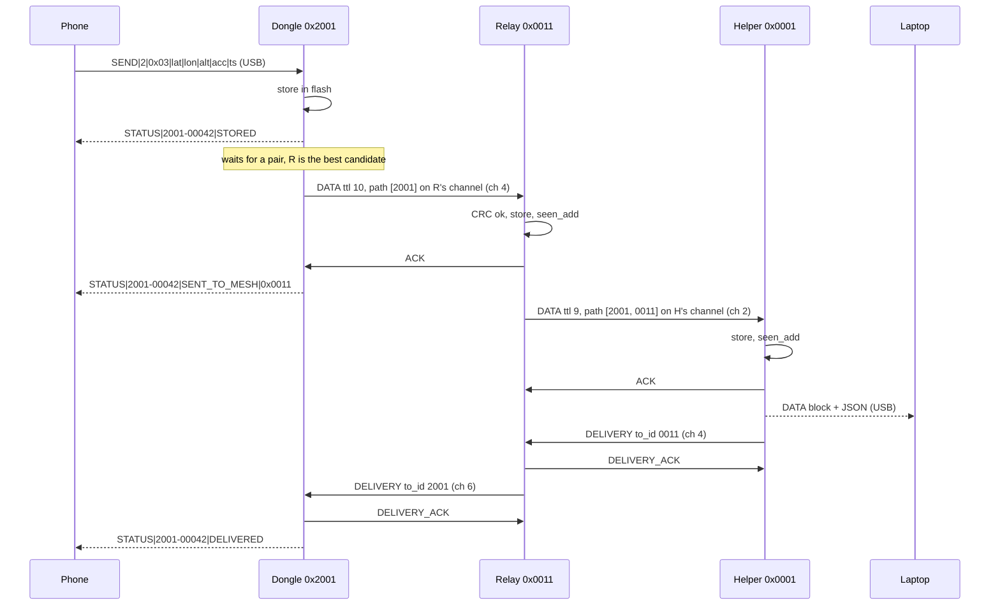

# Dhruva Jaal: algorithm design (V1)

How every node decides **when** to transmit, **on which channel**, **to whom**, and what it does with each packet it receives. It covers any number of nodes. The packet formats are in [packet-design.md](packet-design.md). The build plan, hardware and milestones are in [plan.md](plan.md).

## Core rules

```
VERIFY  before STORE      (CRC8 + length + version)
STORE   before ACK        (flash write finishes before the ACK goes out)
STORE   before FORWARD    (a message is never only in RAM)
RETRY   when ACK is missing
DEDUPLICATE by (source_id, message_id)
LIMIT   propagation with TTL
USE     geography to pick the next hop instead of flooding
KEEP    several forwarding options for resilience
PREFER  reliability over latency
```

Priority order: **reliability > link stability > network capacity > latency.**

## 1. Roles

Each role runs the same mesh code. Only the role and its config differ.

| | Helper | Relay (balloon or ground) | Dongle |
| --- | --- | --- | --- |
| Time sync | root, sync_depth 0 | from its parent's HELLO | from its parent's HELLO |
| Sends HELLO / INI | yes, HELLO in slot 0 | yes, in a random control slot | **never** |
| Accepts DATA | yes (final stop) | yes, stores and forwards | **no** (never relays) |
| Sends | ACK, DELIVERY | ACK, forwarded DATA, DELIVERY, DELIVERY_ACK | its own DATA, DELIVERY_ACK |
| GPS | no (fixed position in flash) | NEO-6M, flash position as fallback | no (position comes from the phone) |
| USB side | readable DATA block + JSON log to the PC | config CLI + JSON log | phone protocol + config CLI |
| In others' neighbour tables | yes | yes | no |

The dongle is a mesh **edge** node. It originates its own messages and receives ACK and DELIVERY for them, but it never forwards anyone else's. That keeps trapped people's batteries for their own SOS, and it keeps dongles, which appear and disappear, out of routing.

## 2. Channel access: hybrid TDM + FDM

The SX1278 is one half-duplex radio. It hears **one** frequency at a time and is deaf while transmitting. FDM therefore only works if the sender knows which channel the receiver is on right now. TDM provides that shared clock.

- **TDM:** time is cut into a repeating **superframe**. A short **control window** has every node on channel 0 for HELLO, INI and time sync. A longer **data window** carries DATA, ACK, DELIVERY and DELIVERY_ACK in 800 ms **pairs**.
- **FDM:** in the data window, every node listens on its own **home channel**, `home_ch(node_id)` (packet design section 7). To send to node X, a node switches to X's channel, transmits, waits there for the ACK, and switches back.

### Superframe

```
SLOT       = 400 ms   (fits the largest packet, 329 ms + guards)
PAIR       = 2 SLOTs = 800 ms   (one DATA or DELIVERY + its ACK)

slot:  0   1   2   3 | 4 5 | 6 7 | ... | 22 23 | 24
       [ CONTROL ch0 ] [P0 ] [P1 ]  ...  [ P9  ] [G]
         HELLO / INI    DATA window, home channels   guard (ch0, flash erase)
```

| Parameter | Demo | Deployment (first guess) |
| --- | --- | --- |
| Superframe | 25 slots (10 s) | 150 slots (60 s) |
| Control slots | 4 | 32 |
| Data pairs | 10 | 58 |
| HELLO interval | every superframe (10 s) | every superframe (60 s) |
| Neighbour STALE after | 3 missed HELLOs (30 s) | 3 missed HELLOs (3 min) |
| Sync lost after no parent beacon for | 6 superframes | 6 superframes |

All of these are set over USB and must be the same on every node.

- **Control window (ch 0).** Slot 0 belongs to the helper, the time root. Every other synced infra node sends its HELLO in a random slot from 1 to `ctrl_slots - 1`, re-picked each superframe, so two nodes that collide once don't collide forever. In its slot a node waits for the guard (25 ms) plus `random(0..3) × 12 ms`, then runs CAD. If the channel is busy, it skips this superframe's HELLO.
- **Data window (home channels).** Exchanges may only **start** at a pair boundary, and each node starts at most one per pair.
- **Guard slot (last slot).** Everyone returns to ch 0. Slow work happens only here: flash sector erase, refilling the job queue.

### Does DATA + ACK fit in one pair? (worst case: largest DATA, 11-entry path)

| Step | ms (cumulative) |
| --- | --- |
| guard at pair start | 25 |
| random start jitter (0–3 × 12 ms) | 61 |
| CAD (~2 symbols at SF9) | 70 |
| DATA, 51 B | 399 |
| receiver: decode, CRC, flash write, build ACK | ~430 |
| ACK, 10 B | ~575 |
| latencies, slack | ~600 |
| **pair length** | **800** (≥ 175 ms margin, including the 25 ms end guard) |

**CAD caveat:** SX127x CAD only detects a **preamble**. A packet that is already past its preamble is invisible to it. The random start jitter is what makes CAD useful in a slotted system: the later starter sees the earlier one's preamble and backs off.

What FDM buys: exchanges with **different** receivers run at the same time on different channels. That matters for balloons, which at altitude all hear each other. With 7 data channels, up to 7 exchanges run in parallel. What it does not fix: everything ends at the helper, so everything ends on the helper's channel. Helper capacity, about 1,000–1,500 messages per hour, stays the bottleneck. Larger areas need more helpers (V2).

## 3. Time sync (works indoors without GPS)

The **helper is the root**. It starts superframe 0 at boot and never syncs to anyone. Every other node, dongles included, syncs from a neighbour's HELLO or INI. GPS time is **not** used for slot timing: indoor nodes have no fix, and two clocks would disagree.

Each beacon carries the sender's `sync_depth` (in `role_flags`) and `sf_offset_ms`: how far into its superframe the sender started this TX.

```
on HELLO/INI from N with depth d_N < 15:
    t_rx     = RxDone interrupt time (µs, esp_timer_get_time)
    t_tx     = t_rx - airtime_us(len) - TX_LATENCY_US      // constant, measured once
    sf_start = t_tx - sf_offset_ms * 1000

    parent choice:
        unsynced              -> adopt N
        d_N < depth(parent)   -> switch to N               // strictly closer to the root
        tie                   -> keep the current parent
    if N is my parent:
        err = sf_start - my_sf_start      (wrapped to ±superframe/2)
        if |err| > 50 ms : my_sf_start  = sf_start         // jump
        else             : my_sf_start += err / 2          // smooth
        my_depth = d_N + 1         (if that reaches 15: unsynced)
        last_parent_beacon = now
```

| State | Radio | May send DATA / DELIVERY | Sends HELLO |
| --- | --- | --- | --- |
| **UNSYNCED** (boot, or parent silent for 6 superframes) | RX on ch 0 all the time | no, messages stay WAITING | INI once at boot, at a random time 0–2 s after start, with CAD |
| **SYNCED** | follows the superframe | yes | yes, in the control window |

- **Loops can't last.** If A syncs from B and B later syncs from A, each beacon raises the other's depth by one until it reaches 15 (unsynced). An unsynced node stops sending HELLOs, so the loop dies out.
- **Drift is a non-issue.** ESP32-C3 crystals are ±10–20 ppm, so two nodes drift ≤ 2.4 ms per minute, far inside the 25 ms guards. All timing uses `esp_timer_get_time()` (64-bit µs), never `millis()`.
- **Target accuracy is ±10 ms** per hop, with `TX_LATENCY_US` calibrated once on two boards.

## 4. Neighbour discovery (infra nodes)

Every HELLO and INI received with a good CRC updates the neighbour table. Discovery is **not** a blocking startup phase: a node starts receiving, forwarding and beaconing straight away.

**Range filter (demo only).** `DEMO_RANGE_KM` (0 = off) is applied first, on every node including dongles: a beacon from a sender farther than `DEMO_RANGE_KM` from this node's position is dropped, so that sender never becomes a neighbour or a candidate. This lets three boards on one table act like nodes 4 km apart. DATA, ACK and DELIVERY need no filter, because they are addressed by `next_hop_id` / `to_id`.

**Neighbour entry** (table of 32; when it is full, the oldest non-ACTIVE entry is replaced):

```
node_id, role, position, position_acc, gps_fix, helper_id (from INI)
rssi, snr (last), snr_avg (EWMA, α = 0.25)
last_seen, last_seq, hello_count, missed_hellos (seq gaps)
ack_history (last 10 sends: ok/fail bits), packets_sent / acked / failed
state, progress_to_helper (metres)
```

**States** (starting values, to tune in tests):

```
          any HELLO/INI
   ──────────────────────────> HEARD
                                 │ ≥ 3 HELLOs AND snr_avg > -10 dB
                                 v              (SF9 floor ≈ -12.5 dB → 2.5 dB margin)
                               ACTIVE
                                 │ 3 consecutive HELLOs missed
                                 │ OR ACK success < 50 % over the last 10 sends (≥ 5 sends)
                                 v
                               STALE ──> forgotten after 10 HELLO intervals of silence
```

- A STALE neighbour that is heard again goes back to HEARD with `hello_count = 0` and a cleared ACK history. It has to earn ACTIVE again with 3 fresh HELLOs. Without that probation, a neighbour made STALE by its ACK rate would never be tried again and could never recover.
- **Balloons drift:** position and `progress_to_helper` are overwritten on every HELLO.
- **Forwarding set:** the best **4** ACTIVE neighbours, ranked as in section 5 and recomputed on every HELLO. The limit is **outbound only**: a node accepts DATA from any node or dongle that names it as `next_hop_id`. Refusing inbound would strand dongles.

**Dongle candidate list.** Dongles keep no states. A candidate is any infra node heard in the last 3 HELLO intervals (30 s demo, 3 min deployment), with its last SNR and position. The number of candidates is the `nodes` value in `INFO` to the phone app.

## 5. Routing: choosing the next hop

Each node routes on its own using local geography. There are no route tables and no full A*. Each node knows:

```
MY position        (GPS, or flash fallback)
HELPER position    (configured over USB)
NEIGHBOUR positions (from their HELLOs)

progress(n) = dist(me, helper) - dist(n, helper)     (2D, altitude ignored)
```

### Infra node (relay)

```
candidates = forwarding set (≤ 4 ACTIVE)
             minus nodes already in path_history          (loop prevention)
             minus nodes that already failed for this message
1. prefer candidates with progress > 0
2. among those: higher ACK success rate, then higher SNR
3. none with progress > 0 -> recovery: any remaining candidate, same order
4. forwarding set exhausted -> recovery: any other ACTIVE neighbour, same rules
5. nothing left -> the message stays STORED, state WAITING
```

A neighbour with no sends yet counts as a 100 % ACK rate, so new links get tried.

### Dongle

```
candidates = infra nodes heard in the last 3 HELLO intervals,
             minus those that already failed for this message
pick the highest SNR; within 1 dB -> the one with the most progress to the helper
none -> WAITING (the phone never has to resend)
```

Dongles pick by SNR first because a trapped dongle's weakest link is its first hop.

### Never drop a message

```
5 retries to the current next hop fail
    -> mark that neighbour as failed for this message, reset the retry count
    -> pick the next candidate
all candidates fail
    -> keep the message STORED, state WAITING
    -> re-evaluate when a neighbour becomes ACTIVE or changes position
    -> and every 60 s (the failed list is cleared, so recovered neighbours are tried again)
```

A node marks a message **FAILED** only when it receives it with `ttl == 0` and it is not the helper. The message stays stored there. No packet reports FAILED back to the source: the source keeps the message as SENT_TO_MESH and simply never gets a DELIVERY.

## 6. Receive algorithm

The radio interrupt (DIO0) only records a flag and a timestamp. Everything else runs in the main loop.

```
on_rx(buf, len, rssi, snr, t_rx):
    hardware CRC error                   -> stats.rx_crc_hw++, drop
    crc8(buf[0..len-2]) != buf[len-1]    -> stats.rx_crc8++,  drop
    version (buf[0] >> 4) != 1           -> drop
    len != expected_len(type)            -> drop     // HELLO 20, INI 25, 10-byte types,
                                                     // DATA 29 + 2n with 1 <= n <= 11
    switch type:
      HELLO, INI:   range filter (section 4)
                    dongle: update candidate list; time sync; done
                    infra:  neighbour_update; time sync; INI -> record helper_id
      DATA:         next_hop_id != me -> stats.overheard++, drop
                    on_data
      ACK:          ack_to == me      -> match against the exchange in progress
      DELIVERY:     to_id == me       -> on_delivery
      DELIVERY_ACK: ack_from == the exchange's target and key matches -> exchange done
```

### on_data: the store-before-ACK path (must finish in ~30 ms)

```
key      = (source_id, message_id)
prev_hop = path_history[path_count - 1]

if seen(key):                         // a retransmission: our ACK was lost
    send ACK now to prev_hop; stats.dup++; return
if I am a dongle:                     // dongles never accept DATA
    return
if the store is full:                 // no ACK: the sender keeps it and tries elsewhere
    log store_full; return

store_append(packet, prev_hop, STORED)    // flash, into pre-erased space
seen_add(key)                             // flash + RAM
send ACK now to prev_hop                  // same channel, no CAD, no backoff

if I am the helper:                   // the helper is the final stop for every DATA
    mark DELIVERED; print the DATA block; log JSON
    queue DELIVERY to prev_hop
elif ttl == 0:
    mark FAILED (TTL expired); log
else:
    queue FORWARD
```

The ACK goes out immediately, with no CAD, on the channel the DATA arrived on. The sender is sitting there waiting, and every other node defers to the pair it already sees in use.

### on_delivery

```
send DELIVERY_ACK now (ack_to = stored next_hop, or 0xFFFF without a record)
if already DELIVERED: return                // duplicate: our DELIVERY_ACK was lost
mark DELIVERED
if source_id == me: report DELIVERED to the phone (dongle); return
if I have the record: queue DELIVERY to its stored prev_hop
else: log (the record was evicted; the chain stops here)
```

## 7. Transmit algorithm

### Job queue

```c
typedef struct {
    uint8_t  kind;            // OWN_DATA, FORWARD, DELIVERY
    uint32_t key;             // source_id << 16 | message_id
    uint16_t target;          // current next hop / to_id
    uint8_t  retries;         // 0..5 for the current target
    uint8_t  n_failed;        // targets that already failed for this job
    uint16_t failed[8];
    int64_t  not_before_us;   // backoff: earliest pair start for the next try
    bool     waiting;         // no candidate; re-evaluated on events and every 60 s
} job_t;
```

- There are 32 jobs in RAM. Any further stored messages stay in flash, and the queue is refilled from the store index in every guard slot.
- Order: **DELIVERY first** (short, and it frees state upstream), then **OWN_DATA**, then **FORWARD** oldest first.
- At every pair boundary, a node with a due job and an idle radio starts one exchange.

### One exchange (initiator side)

```
wait 25 ms guard + random(0..3) * 12 ms
target = job.target, or pick one (section 5); none -> job.waiting, stop
switch to home_ch(target)
CAD
    busy -> job.not_before = now + random(1..4) pairs   (not counted as a retry)
            back to my home channel; stop
build the packet:
    FORWARD   copy the stored DATA, ttl--, append my id, next_hop_id = target
    OWN_DATA  the stored DATA, next_hop_id = target
    DELIVERY  helper_id, to_id = target, key
transmit, then RX on the same channel
wait for the matching ACK / DELIVERY_ACK until pair end - 25 ms
    ACK match:          ack_from == target AND ack_to == me AND key
    DELIVERY_ACK match: ack_from == target AND key
on match:
    DATA:     store next_hop = target, state SENT_TO_MESH (handed off); remove the job
    DELIVERY: delivery done; remove the job
    neighbour[target]: ok in ack_history
no match:
    neighbour[target]: fail in ack_history
    job.retries++
    retries <= 5 -> job.not_before = now + random(1 .. min(2^retries, 16)) pairs
    retries >  5 -> add target to job.failed, retries = 0, pick a new target
back to my home channel, RX
```

| Retry k | Backoff before it |
| --- | --- |
| 1 | 1–2 pairs |
| 2 | 1–4 pairs |
| 3 | 1–8 pairs |
| 4 | 1–16 pairs |
| 5 | 1–16 pairs |

A neighbour costs at most 6 TX plus 46 pairs (about 37 s) before the next candidate is tried.

**DELIVERY retries.** The target of a DELIVERY is fixed (the stored prev_hop), so there is no "next candidate". After 5 failed retries the job waits 60 s and starts a new round of 5. After 5 rounds it gives up and logs it. A dongle that was switched off or moved should not keep a relay transmitting forever.

### The receiving side of an exchange

Nothing special happens there. A synced node already sits in RX on its home channel during the data window, and `on_data` / `on_delivery` reply at once (section 6). While a node is away on another node's channel waiting for an ACK, it is deaf on its own channel. Anything sent to it then fails and is retried, which is acceptable.

## 8. End to end



## 9. Message states

These are kept per message on every node. The dongle also reports them to the phone (`STATUS`, [../docs/usb-protocol.md](../docs/usb-protocol.md)).

| State | Meaning | In flash? |
| --- | --- | --- |
| QUEUED | dongle got `SEND`, not yet written | no |
| STORED | in flash, not handed off yet | yes |
| WAITING | stored, no usable neighbour (or not synced yet) | no (a STORED message without a job) |
| TRANSMITTING | an exchange for it is in progress | no |
| SENT_TO_MESH | a next hop ACKed it (handed off) | yes |
| DELIVERED | DELIVERY received (or this node is the helper) | yes |
| FAILED | dongle: could not store it (store full / bad SEND); relay: TTL ran out here | yes |

The dongle sends each state to the phone once, when it changes: QUEUED as soon as `SEND` arrives (its first `STATUS` tells the app the message ID), STORED after the flash write, then the rest.

## 10. Storage (store before ACK in ~10 ms)

LittleFS is not used. A file write can trigger a 4 KB sector erase that takes 45 ms typical and up to ~400 ms on NOR flash, which would miss the ACK deadline at random. Instead, messages go into a raw flash partition with erased space kept ready in advance.

**Partition `mesh`** (data, subtype `0x40`, 256 KB):

| Region | Size | Holds |
| --- | --- | --- |
| Message log | 128 KB = 32 sectors × 64 records | 2,048 records of 64 B |
| Seen-set log | 48 KB = 12 sectors × 1,024 keys | 4 B keys; ≥ 11,264 kept after an erase (spec: 10,000) |

**Message record (64 B)**

| Offset | Field | Notes |
| --- | --- | --- |
| 0 | magic | `0xA5`, written **last**, so a torn write never looks valid |
| 1 | state | `0xFE` STORED → `0xFC` SENT_TO_MESH → `0xF8` DELIVERED; `0xF0` FAILED |
| 2 | delivery state | `0xFF` none → `0xFE` DELIVERY owed → `0xFC` done; `0xF8` given up |
| 3 | own | `0x00` = this node created it, `0xFF` = relayed |
| 4 | prev_hop | uint16 |
| 6 | next_hop | uint16, `0xFFFF` until handed off, then programmed once |
| 8 | length | of the raw DATA |
| 9 | raw DATA | ≤ 51 B, exactly as received (before this node's ttl--) |
| 60 | reserved | |

- **State changes without an erase.** NOR flash can only clear bits (1 → 0). Each state step clears more bits, so a state change programs one byte in place.
- **Erase ahead.** At least 2 erased sectors are kept ahead of each write head. Erasing happens only in the guard slot, one sector per superframe at most, never during an exchange.
- **Eviction.** The ring overwrites the oldest sector first. Before a sector is erased, any record in it that is still **STORED** (not handed off) or still owes a DELIVERY is copied to the head. A message this node has not handed off is never evicted. If those records alone fill the store, the node stops accepting DATA (no ACK), and its neighbours route around it.
- **Seen set.** A RAM mirror of the seen log (48 KB) is checked with a linear scan (~100 µs). It is persisted, so a rebooted node does not accept and forward old messages again.
- **Boot.** Both logs are scanned (~10 ms). The write head is the start of the erased gap. The RAM index (key → record, state, prev_hop, next_hop) and the seen mirror are rebuilt, and jobs are reloaded for STORED messages and owed DELIVERYs. That is why a relay rebooted mid-flow loses nothing and the PC shows no duplicate.
- **Own message counter.** `message_id` for own messages lives in NVS (`Preferences`) and is written once per message.

## 11. Positions and GPS

| Node | Position used in HELLO / INI / DATA and for routing |
| --- | --- |
| Relay (balloon, ground) | NEO-6M live fix: `gps_fix = 1`, `position_acc ≈ HDOP × 2.5 m`. Before the first fix: the flash fallback position, `gps_fix = 0`, acc `0xFFFF`. On fix loss (> 10 s): the last GPS position, `gps_fix = 0`. The first fix triggers an INI. |
| Helper | Its flash position, the same one every node is configured with as `helper position`. |
| Dongle | DATA carries the **phone's** position from `SEND`. If the phone has no fix: the dongle's stored position if one is set, else 0, with `position_acc = 0xFF`. The stored position is also used for the range filter and tie-breaks. |

GPS time fills `gps_time` in INI and the timestamp of messages a relay creates itself (the `send` test command). It is never used for slot timing (section 3).

## 12. Failure behaviour

| What happens | What the mesh does |
| --- | --- |
| Next hop is off | 5 retries with backoff, then the next candidate; no candidate → WAITING; resent when a neighbour reappears (store and forward) |
| ACK lost | Sender retries; receiver sees a duplicate, does not store it again, ACKs again |
| ACK lost, and the sender already moved to another neighbour | Two copies travel; the helper de-duplicates; DELIVERY returns along the first path; the DELIVERY_ACK match on `ack_from` + key still closes it |
| Relay reboots mid-flow | Messages and the seen set are in flash; jobs are reloaded at boot; no duplicate at the helper |
| Helper off | Every message waits (STORED / WAITING) at the last relay or the dongle and goes out when the helper's HELLOs return |
| Node loses its time parent | After 6 silent superframes it is UNSYNCED: RX on ch 0, messages wait, and it re-syncs from the next HELLO it hears |
| Routing dead end (no neighbour makes progress) | Recovery: any candidate not in `path_history`; TTL stops it after 10 hops |
| Balloon drifts | Its position is refreshed on every HELLO, and next-hop choices follow it |
| Store full | No ACK, so upstream nodes keep their copy and route elsewhere; nothing is overwritten that was not handed off |
| Channel busy | CAD, then a random 1–4 pair wait (not counted as a retry) |
